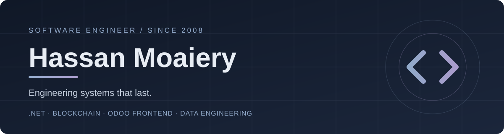

 

**Full-Stack Developer · .NET Ecosystem · Enterprise Web Applications**

Building maintainable, production-oriented software with a focus on backend engineering, architecture, and practical user experiences.

### About

I'm a software developer working with web technologies since **2008**, primarily in the **Microsoft .NET ecosystem**. My work includes database-driven platforms, multilingual websites, business applications, ticketing workflows, and integrations.

- **Core focus:** C#, ASP.NET Core, MVC, REST APIs, SQL Server, and application architecture.
- **Frontend:** JavaScript, HTML, CSS, Bootstrap; expanding my work with React and Tailwind CSS.
- **Also working with:** Odoo customization, RTL interfaces, and multilingual web experiences.
- **Engineering priorities:** maintainability, security, performance, and thoughtful UX.

### Technology stack

**Backend & data**

**Frontend & platforms**

-161b22?style=for-the-badge&logo=react&logoColor=61DAFB)
-161b22?style=for-the-badge&logo=tailwindcss&logoColor=06B6D4)

### Selected work

| Project | Focus |
|:--|:--|
| [Global Trade Canada](https://github.com/hmoaiery/GlobalTradeCanada.ca) | Multilingual ASP.NET Core business platform |
| [PuzzleShow.Core](https://github.com/hmoaiery/PuzzleShow.Core) | Ticketing workflows, access control, and secure ticket recovery |
| [Odoo Persian Ecommerce Theme](https://github.com/hmoaiery/odoo-persian-ecommerce-theme) | RTL-first Odoo ecommerce theme and customizable components |
| [Adadak](https://github.com/hmoaiery/Adadak) | .NET-based multiplayer number puzzle game |

> Some commercial work is private. Public repositories represent selected examples, not the full scope of my work.

### GitHub activity

---

Engineering reliable software, one meaningful improvement at a time.

